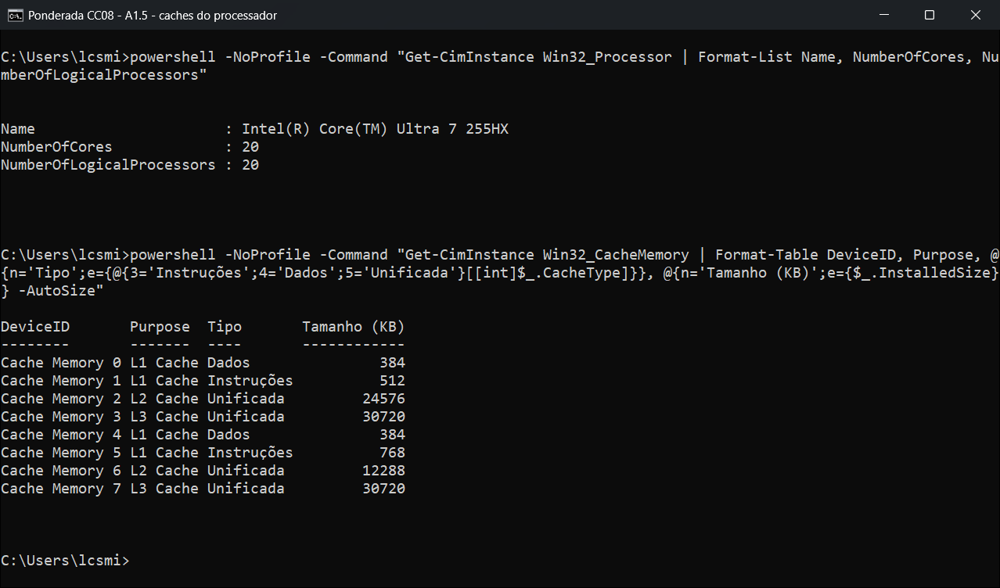
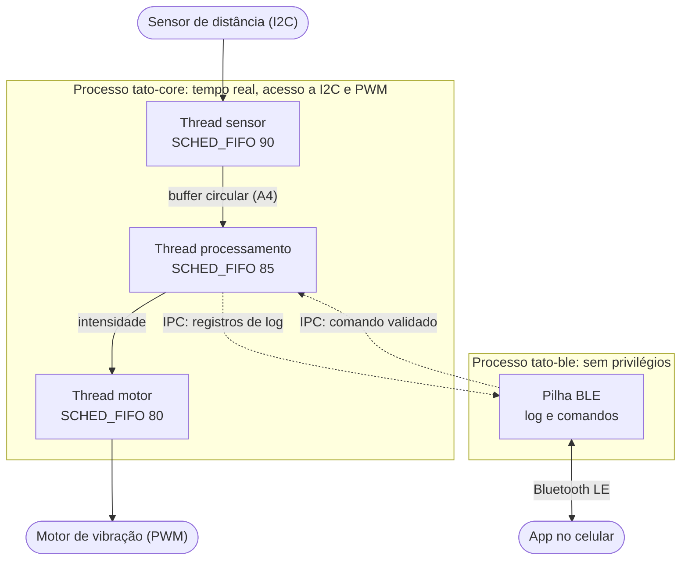
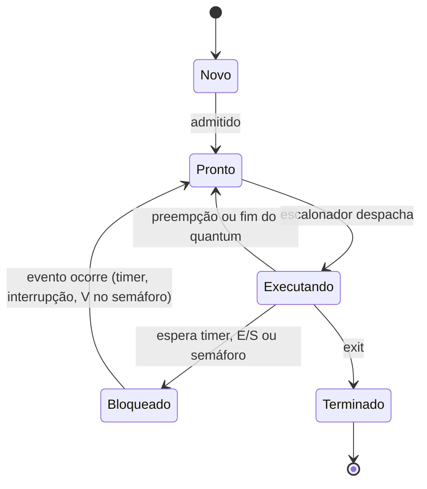
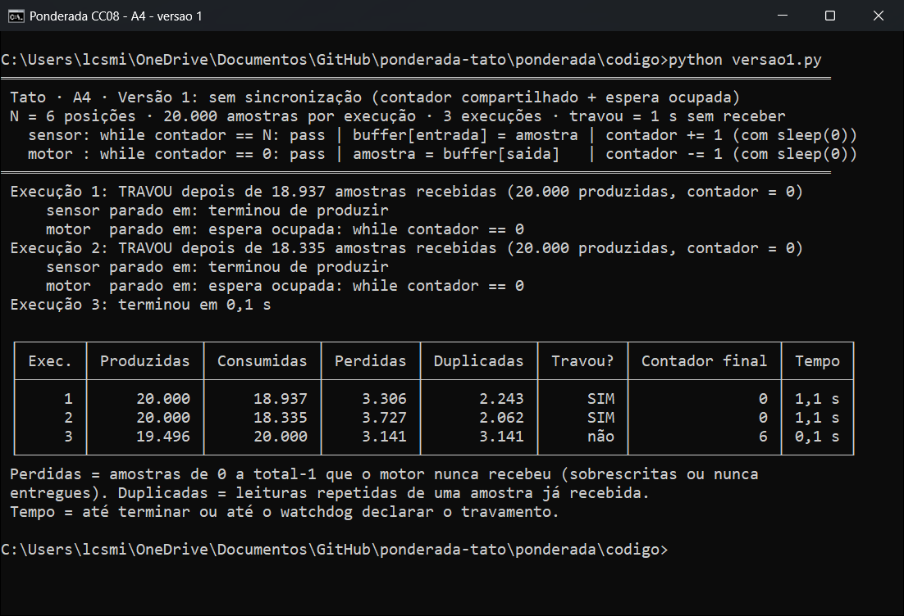
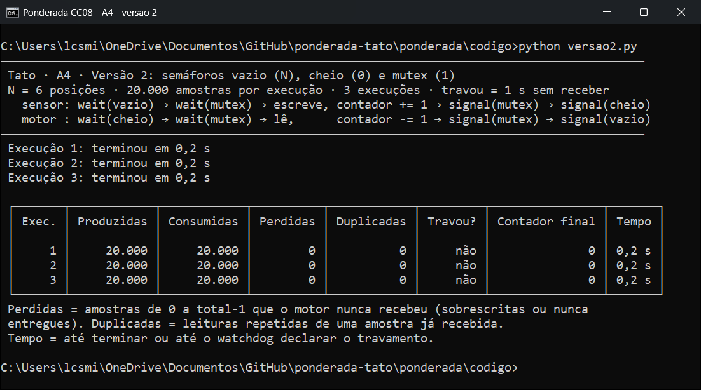
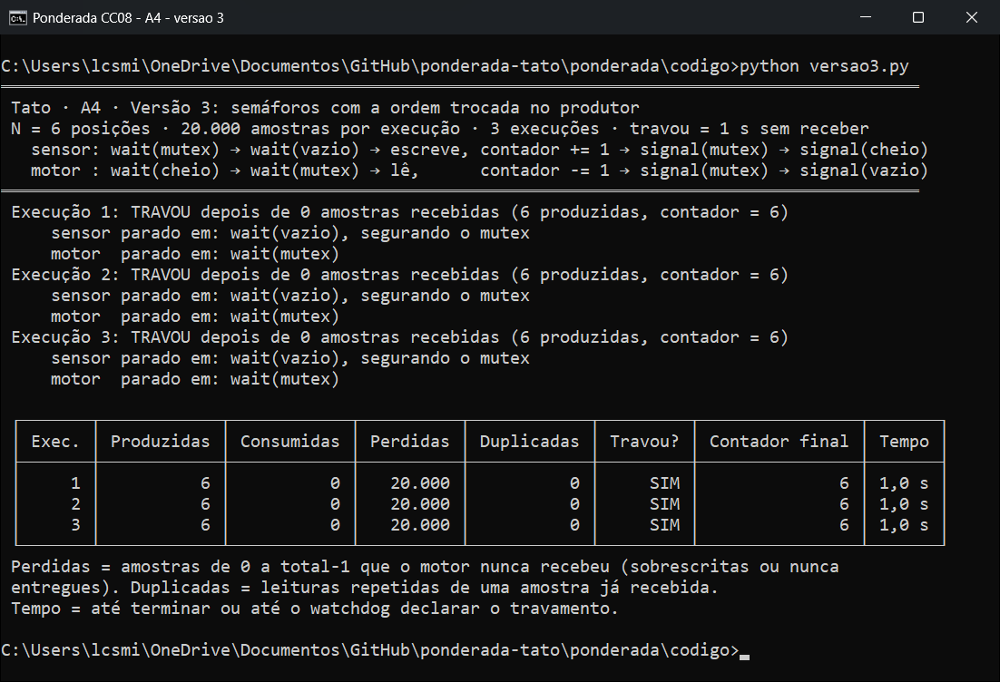
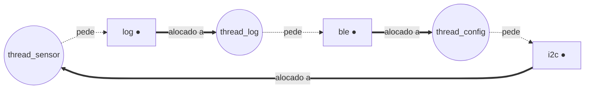

**Lucas Michel Pereira** · D1 = 5 · D2 = 8 · N = 6

# Ponderada CC08: do pipeline ao deadlock

Sou CTO da Tato, uma pulseira sensorial para pessoas com deficiência visual. A pulseira lê um sensor de distância a cada 10 ms (100 Hz), transforma a proximidade de obstáculos em vibração e manda um log por BLE para o app no celular. O requisito que não se negocia é **processar cada amostra em no máximo 5 ms**.

## Parâmetros individuais

Nome completo: **Lucas Michel Pereira**. Contando só as letras: Lucas (5) + Michel (6) + Pereira (7) = **18 letras**.

- **D1** = letras do primeiro nome = **5**
- **D2** = último dígito do total (18) = **8**

| Parâmetro | Fórmula | Conta | Valor |
| :-- | :-- | :-- | --: |
| Instruções por amostra (IC) | 100.000 + 20.000 × D2 | 100.000 + 20.000 × 8 = 100.000 + 160.000 | **260.000** |
| Taxa de falta na L1 do SoC (m) | 3% + 0,5% × D1 | 3% + 0,5% × 5 = 3% + 2,5% | **5,5%** |
| Tamanho do buffer (N) | 3 + (D2 mod 5) | 3 + (8 mod 5) = 3 + 3 | **6** |

---

# Parte A: o problema técnico

## A1. Arquitetura e memória: qual processador vai na pulseira?

### A1.1 Plataforma H (Harvard, 48 MHz, CPI = 1,5)

```text
ciclos = IC × CPI        = 260.000 × 1,5             = 390.000 ciclos
tempo  = ciclos ÷ clock  = 390.000 ÷ 48.000.000 Hz   = 0,008125 s = 8,125 ms
```

**8,125 ms > 5 ms: a Plataforma H não atende.** Ela estoura o limite em 3,125 ms (62,5% acima). Para caber em 5 ms, a H poderia executar no máximo 5 ms × 48.000.000 Hz ÷ 1,5 = 160.000 instruções por amostra, e o meu IC é 260.000. Sem sistema operacional e sem cache, esse tempo é fixo: o pior caso da H é igual ao caso médio.

### A1.2 Plataforma V (Von Neumann, 1,2 GHz, cache L1 com m = 5,5%)

```text
AMAT    = tempo de acerto + m × penalidade
        = 1 + 0,055 × 120 = 1 + 6,6                  = 7,6 ciclos  (7,6 ÷ 1,2 GHz ≈ 6,33 ns)

CPI_ef  = 1,0 + (acessos por instrução × m × penalidade)
        = 1,0 + (1,3 × 0,055 × 120) = 1,0 + 8,58      = 9,58 ciclos por instrução

ciclos  = IC × CPI_ef = 260.000 × 9,58                = 2.490.800 ciclos
tempo   = 2.490.800 ÷ 1.200.000.000 Hz                = 2,076 ms   (caso médio)
pior    = 2,076 ms + 3 ms (atraso do Linux)            = 5,076 ms   (pior caso)
```

- **Caso médio: 2,076 ms ≤ 5 ms**, com folga de 2,924 ms.
- **Pior caso: 5,076 ms > 5 ms, não atende**: estoura por 0,076 ms (76 µs, 1,5% acima).

Como o requisito vale para **cada** amostra ("no máximo 5 ms"), quem decide é o pior caso. **A Plataforma V não atende.** Um detalhe que explica o resultado: dos 9,58 ciclos por instrução, 8,58 (89,6%) são a CPU parada esperando a memória. A V tem clock 25 vezes maior que o da H, mas no caso médio é só 3,9 vezes mais rápida (8,125 ÷ 2,076).

### A1.3 Acelerador DSP na Plataforma H (Lei de Amdahl)

O filtro é a fração f = 0,6 do tempo e fica k = 5 vezes mais rápido.

```text
S     = 1 ÷ [(1 − f) + f ÷ k] = 1 ÷ [0,4 + 0,6 ÷ 5] = 1 ÷ (0,4 + 0,12) = 1 ÷ 0,52 ≈ 1,923
T_DSP = 8,125 ms ÷ 1,923 = 8,125 ms × 0,52 = 4,225 ms

conferindo por partes:
  filtro: 0,6 × 8,125 = 4,875 ms  →  4,875 ÷ 5 = 0,975 ms
  resto:  0,4 × 8,125 = 3,250 ms  →  inalterado
  total:  0,975 + 3,250            = 4,225 ms
```

**Speedup global de 1,92 vezes, 4,225 ms por amostra: agora a H atende**, com folga de 0,775 ms (15,5%). Como continua sem sistema operacional, esse é também o pior caso.

- Limite de Amdahl: mesmo com um DSP infinitamente rápido, S_máx = 1 ÷ 0,4 = 2,5, ou seja, 3,25 ms. Os 40% que não são filtro passam a mandar no tempo.
- Aceleração mínima que o DSP precisa entregar: 8,125 × (0,4 + 0,6 ÷ k) ≤ 5, então k ≥ 0,6 ÷ (5 ÷ 8,125 − 0,4) ≈ **2,79**. Uso esse número no memorando da Parte B.

| Cenário | Tempo por amostra | Atende 5 ms? | Folga |
| :-- | --: | :-: | --: |
| H | 8,125 ms | não | −3,125 ms |
| H + DSP | **4,225 ms** | **sim** | **+0,775 ms (15,5%)** |
| V, caso médio | 2,076 ms | sim | +2,924 ms |
| V, pior caso (+3 ms do SO) | **5,076 ms** | **não** | **−0,076 ms** |

### A1.4 Por que a V precisa de cache e a H funciona sem?

1. Na V, instruções e dados saem da mesma DRAM externa pelo mesmo barramento: é o gargalo de Von Neumann.
2. Cada ida à DRAM custa 120 ciclos. Sem cache, CPI ≈ 1 + 1,3 × 120 = 157, o que dá 34 ms por amostra.
3. A L1 atende 94,5% dos acessos em 1 ciclo e derruba esse tempo para 2,08 ms (AMAT de 7,6 ciclos em vez de 120).
4. A H é Harvard: busca instrução e dado por barramentos separados, numa SRAM interna de 1 ciclo.
5. A 48 MHz a memória acompanha a CPU, então não existe atraso para uma cache esconder.

### A1.5 Evidência da minha máquina



O CPU-Z não está instalado nesta máquina, então usei a mesma informação pelo próprio Windows: a classe `Win32_CacheMemory`, que lê as tabelas SMBIOS do firmware (comando visível no print). Conferi a divisão por núcleo com a API `GetLogicalProcessorInformationEx`, que lê os descritores de cache (CPUID) de cada núcleo. O processador é um **Intel Core Ultra 7 255HX**, com 20 núcleos: 8 de desempenho (P) e 12 de eficiência (E), sem hyper-threading. O print traz um bloco de caches para cada tipo de núcleo:

| Cache | Tipo | Núcleos P (8) | Núcleos E (12) |
| :-- | :-- | :-- | :-- |
| L1 | **Dados** | 384 KB ÷ 8 = **48 KB por núcleo** | 384 KB ÷ 12 = **32 KB por núcleo** |
| L1 | **Instruções** | 512 KB ÷ 8 = **64 KB por núcleo** | 768 KB ÷ 12 = **64 KB por núcleo** |
| L2 | Unificada | 24.576 KB ÷ 8 = 3 MB por núcleo | 12.288 KB ÷ 3 = 4 MB por grupo de 4 núcleos |
| L3 | Unificada | 30 MB compartilhados pelos 20 núcleos | (mesma L3) |

**Sim, a minha L1 é dividida em instruções e dados** (linhas "L1 Cache / Dados" e "L1 Cache / Instruções" do print). **Mesmo assim, o computador é Von Neumann.** Programa e dados ficam na mesma RAM, no mesmo espaço de endereçamento: o sistema operacional carrega um programa lendo o executável como dado, e L2, L3 e RAM são unificadas. A separação existe só no primeiro nível, o que se chama de **Harvard modificada**: com L1i e L1d separadas, o núcleo busca uma instrução e acessa um dado no mesmo ciclo. É isso que deixa os estágios IF e MEM do pipeline da A2 trabalharem juntos sem conflito estrutural, atenuando o gargalo de Von Neumann sem mudar o modelo de memória.

---

## A2. Pipeline: o loop do filtro

```text
I1  lw   x5, 0(x10)     # lê a amostra nova
I2  add  x6, x6, x5     # soma += nova
I3  lw   x7, 0(x11)     # lê a amostra mais antiga
I4  sub  x6, x6, x7     # soma -= antiga
I5  sw   x6, 0(x12)     # grava a soma
I6  addi x10, x10, 4    # avança o ponteiro da nova
I7  addi x11, x11, 4    # avança o ponteiro da antiga
```

Pipeline clássico de 5 estágios (IF, ID, EX, MEM, WB). O banco de registradores é escrito na 1ª metade do ciclo e lido na 2ª, então uma instrução pode ler em ID, no mesmo ciclo, um valor que outra está gravando em WB.

### A2.1 Dependências de dados (RAW)

| # | Produtora → consumidora | Registrador | Tipo |
| :-: | :-- | :-: | :-- |
| 1 | I1 `lw` → I2 `add` | **x5** | load seguido de uso |
| 2 | I2 `add` → I4 `sub` | **x6** | ULA → ULA |
| 3 | I3 `lw` → I4 `sub` | **x7** | load seguido de uso |
| 4 | I4 `sub` → I5 `sw` | **x6** | ULA → store (o valor a gravar) |

Não há outras RAW dentro do trecho. Outras dependências que não causam bolha, mas limitam a reordenação da A2.4: **WAR** I1 → I6 (x10) e I3 → I7 (x11), porque o ponteiro só pode avançar depois de ser usado; **WAW** I2 → I4 (x6). Entre iterações do laço também existem I6 → I1, I7 → I3 e I4 → I2 da iteração seguinte, que ficam fora da conta deste trecho.

### A2.2 Sem forwarding

Legenda: `—` é uma bolha (stall). A instrução fica retida no estágio à esquerda do traço: em ID, se ela é a dependente; em IF, se está logo atrás da dependente.

| Instrução | 1 | 2 | 3 | 4 | 5 | 6 | 7 | 8 | 9 | 10 | 11 | 12 | 13 | 14 | 15 | 16 | 17 |
|:--|:-:|:-:|:-:|:-:|:-:|:-:|:-:|:-:|:-:|:-:|:-:|:-:|:-:|:-:|:-:|:-:|:-:|
| I1 `lw x5, 0(x10)` | IF | ID | EX | MEM | WB |  |  |  |  |  |  |  |  |  |  |  |  |
| I2 `add x6, x6, x5` |  | IF | ID | — | — | EX | MEM | WB |  |  |  |  |  |  |  |  |  |
| I3 `lw x7, 0(x11)` |  |  | IF | — | — | ID | EX | MEM | WB |  |  |  |  |  |  |  |  |
| I4 `sub x6, x6, x7` |  |  |  |  |  | IF | ID | — | — | EX | MEM | WB |  |  |  |  |  |
| I5 `sw x6, 0(x12)` |  |  |  |  |  |  | IF | — | — | ID | — | — | EX | MEM | WB |  |  |
| I6 `addi x10, x10, 4` |  |  |  |  |  |  |  |  |  | IF | — | — | ID | EX | MEM | WB |  |
| I7 `addi x11, x11, 4` |  |  |  |  |  |  |  |  |  |  |  |  | IF | ID | EX | MEM | WB |

| Bolhas | Quem espera | O quê | Por quê |
| :-- | :-- | :-- | :-- |
| ciclos 4–5 (2) | I2 retida em ID, I3 em IF | x5 de I1 | I1 só grava x5 no WB do ciclo 5; I2 lê na 2ª metade do ciclo 5 |
| ciclos 8–9 (2) | I4 retida em ID, I5 em IF | x7 de I3 (e x6 de I2) | I3 grava x7 no ciclo 9, que é o último a ficar pronto |
| ciclos 11–12 (2) | I5 retida em ID, I6 em IF | x6 de I4 | I4 grava x6 no ciclo 12 |

**Total sem forwarding: 17 ciclos** do primeiro IF (ciclo 1) ao último WB (ciclo 17), ou seja, os 11 ciclos ideais (5 + 7 − 1) mais 6 bolhas.

### A2.3 Com forwarding (EX/MEM → EX e MEM/WB → EX)

| Instrução | 1 | 2 | 3 | 4 | 5 | 6 | 7 | 8 | 9 | 10 | 11 | 12 | 13 |
|:--|:-:|:-:|:-:|:-:|:-:|:-:|:-:|:-:|:-:|:-:|:-:|:-:|:-:|
| I1 `lw x5, 0(x10)` | IF | ID | EX | MEM | WB |  |  |  |  |  |  |  |  |
| I2 `add x6, x6, x5` |  | IF | ID | — | EX | MEM | WB |  |  |  |  |  |  |
| I3 `lw x7, 0(x11)` |  |  | IF | — | ID | EX | MEM | WB |  |  |  |  |  |
| I4 `sub x6, x6, x7` |  |  |  |  | IF | ID | — | EX | MEM | WB |  |  |  |
| I5 `sw x6, 0(x12)` |  |  |  |  |  | IF | — | ID | EX | MEM | WB |  |  |
| I6 `addi x10, x10, 4` |  |  |  |  |  |  |  | IF | ID | EX | MEM | WB |  |
| I7 `addi x11, x11, 4` |  |  |  |  |  |  |  |  | IF | ID | EX | MEM | WB |

- I2 recebe x5 de I1 por MEM/WB → EX no ciclo 5: **1 bolha** (ciclo 4).
- I4 recebe x7 de I3 por MEM/WB → EX no ciclo 8: **1 bolha** (ciclo 7). O x6 de I2 já está no banco de registradores (WB no ciclo 7).
- I5 recebe x6 de I4 por EX/MEM → EX no ciclo 9: **sem bolha**.

**Total com forwarding: 13 ciclos** (11 + 2 bolhas).

**O que continua causando bolha são as dependências load seguido de uso: I1 → I2 (x5) e I3 → I4 (x7).** Um `lw` só tem o valor no fim do estágio MEM, porque é ali que a memória responde. A instrução seguinte precisa desse valor no começo do EX, e sem bolha o EX dela cairia no mesmo ciclo do MEM do `lw`. Forwarding leva um valor para frente no tempo, nunca para trás: o melhor possível é entregar o dado por MEM/WB no ciclo seguinte, então sobra 1 bolha para cada load seguido de uso. Já as dependências ULA → ULA (I2 → I4) e ULA → store (I4 → I5) são resolvidas por completo, porque o resultado da ULA sai no fim do EX, a tempo do EX seguinte.

### A2.4 Reordenação sem bolhas

Basta trocar I2 com I3. As duas são independentes (I3 lê x11 e grava x7; I2 lê x6 e x5 e grava x6), então o resultado não muda. Agora existe uma instrução entre cada `lw` e o seu uso:

```text
I1  lw   x5, 0(x10)
I3  lw   x7, 0(x11)
I2  add  x6, x6, x5     # x5 chega por MEM/WB (I1 está 2 instruções antes)
I4  sub  x6, x6, x7     # x7 por MEM/WB (I3) e x6 por EX/MEM (I2)
I5  sw   x6, 0(x12)     # x6 por EX/MEM (I4)
I6  addi x10, x10, 4
I7  addi x11, x11, 4
```

| Instrução | 1 | 2 | 3 | 4 | 5 | 6 | 7 | 8 | 9 | 10 | 11 |
|:--|:-:|:-:|:-:|:-:|:-:|:-:|:-:|:-:|:-:|:-:|:-:|
| I1 `lw x5, 0(x10)` | IF | ID | EX | MEM | WB |  |  |  |  |  |  |
| I3 `lw x7, 0(x11)` |  | IF | ID | EX | MEM | WB |  |  |  |  |  |
| I2 `add x6, x6, x5` |  |  | IF | ID | EX | MEM | WB |  |  |  |  |
| I4 `sub x6, x6, x7` |  |  |  | IF | ID | EX | MEM | WB |  |  |  |
| I5 `sw x6, 0(x12)` |  |  |  |  | IF | ID | EX | MEM | WB |  |  |
| I6 `addi x10, x10, 4` |  |  |  |  |  | IF | ID | EX | MEM | WB |  |
| I7 `addi x11, x11, 4` |  |  |  |  |  |  | IF | ID | EX | MEM | WB |

**Novo total: 11 ciclos, sem nenhuma bolha** (5 + 7 − 1). A WAR continua respeitada: I6 e I7 seguem depois dos loads que usam x10 e x11.

| Cenário | Ciclos | Bolhas |
| :-- | :-: | :-: |
| Sem forwarding | 17 | 6 |
| Com forwarding | 13 | 2 |
| Com forwarding e reordenado | **11** | **0** |

Outra ordem válida é I1, I3, I6, I2, I7, I4, I5, que adianta também os `addi`. Com forwarding ela dá os mesmos 11 ciclos, mas sem forwarding cai de 17 para 14 ciclos (a troca simples dá 16), porque afasta ainda mais cada produtora da sua consumidora. É o tipo de escalonamento de instruções que um compilador faz sozinho.

---

## A3. Processos e threads: como organizar o software

### A3.1 Organização proposta (Plataforma V, Linux)

**Dois processos.** As três tarefas do caminho crítico viram **threads de um processo de tempo real** (`tato-core`), e o BLE vira um **processo separado e sem privilégios** (`tato-ble`).



| Tarefa | Vira | Motivo principal |
| :-- | :-- | :-- |
| Ler o sensor | thread do `tato-core` | produz a amostra que as outras duas usam; precisa de prioridade alta e do I2C |
| Processar a amostra | thread do `tato-core` | lê a amostra direto do buffer em memória, sem cópia |
| Acionar o motor | thread do `tato-core` | recebe a intensidade pela memória compartilhada, dentro dos 5 ms |
| BLE (log e comandos) | processo `tato-ble` | fala com o mundo de fora, não é tempo real e pode cair sem parar a vibração |

- **Compartilhamento de memória.** Sensor, processamento e motor trocam 100 amostras por segundo e têm 5 ms para tudo. Como threads do mesmo processo, enxergam o mesmo espaço de endereçamento: passar uma amostra é escrever num buffer circular protegido por semáforos (exatamente a A4), sem cópia e sem atravessar o kernel no caminho rápido. O BLE só precisa de uma cópia do log e recebe poucos comandos. Pagar alguns microssegundos de IPC (socket Unix ou fila de mensagens POSIX) não pesa, e o log pode atrasar sem prejuízo para quem usa a pulseira.
- **Custo de criação e de troca de contexto.** Criar uma thread (`clone` compartilhando a memória) é mais barato que criar um processo (`fork`, com tabelas de páginas novas). Só que tudo é criado uma vez, no boot, então o custo que importa é o da troca de contexto, que acontece várias vezes por amostra, 100 vezes por segundo. Entre threads do mesmo processo o espaço de endereçamento não muda; entre processos ele muda (tabelas de páginas, TLB). Por isso as três tarefas críticas ficam como threads, e o BLE, que é acordado raramente, pode ser processo.
- **Isolamento de falhas.** Uma falha grave (segfault) em qualquer thread derruba o processo inteiro. Sensor, processamento e motor são código pequeno, nosso, testado, e já dependem uns dos outros: se um morre, a pulseira não funciona de qualquer jeito. A pilha BLE é grande, recebe dados de fora e lida com reconexões e timeouts. Como processo separado, se ela travar ou cair, o supervisor (systemd) a reinicia e a vibração continua.
- **Ajustes de tempo real** que acompanham essa organização: `SCHED_FIFO` com prioridades 90/85/80 no `tato-core`, `mlockall()` para não haver falta de página no caminho crítico e um núcleo da CPU dedicado; o `tato-ble` roda em `SCHED_OTHER`, com prioridade baixa.

Eu não separaria tudo em processos porque cada amostra passaria por dois canais de IPC, com cópias, chamadas ao kernel e trocas de espaço de endereçamento: mais latência e mais variação de latência dentro de um orçamento que, no pior caso da A1, já não fecha. Também não deixaria o BLE como thread, pelo motivo da A3.2.

### A3.2 Se alguém explorar uma falha no BLE

| | BLE como **thread** do `tato-core` | BLE como **processo** separado |
| :-- | :-- | :-- |
| Memória que o atacante alcança | toda a do processo: buffer de amostras, filtro, configuração, tudo | só a do `tato-ble`; a MMU impede acessar a memória do `tato-core` |
| O que ele consegue fazer | silenciar o motor ou gerar vibração falsa (a pessoa anda sem aviso, ou desvia de nada), mexer no I2C e no PWM, roubar dados, ficar residente | só mandar mensagens pelo canal de IPC, que o `tato-core` valida (formato fixo, faixas de valores, limite de frequência) |
| Privilégios | os do processo de tempo real, com acesso a I2C e PWM | usuário sem privilégios, `seccomp`, sem acesso a `/dev/i2c` nem ao PWM |
| Se o ataque só derrubar o BLE | cai o processo inteiro: a pulseira para de vibrar | cai só o BLE: o supervisor reinicia e a vibração continua |
| Para chegar ao núcleo | não precisa de mais nada | precisa de uma segunda falha, no kernel, para escalar privilégio |

Como thread, uma única falha no código mais exposto do sistema entrega o controle da função de segurança da pulseira. Como processo, o estrago fica contido a "log e configuração não funcionam", e o atacante ainda precisa vencer uma segunda barreira (defesa em profundidade, menor privilégio). O risco que sobra é um comando malicioso, porém bem formado. Por isso o `tato-core` impõe limites que o BLE não consegue mudar, por exemplo intensidade mínima de vibração e nenhum comando capaz de desligar o aviso de obstáculo, e só aceita comandos de um celular pareado e autenticado.

### A3.3 Diagrama de estados de um processo



**A thread do sensor passa a maior parte do tempo em Bloqueado (Esperando).** Ela é periódica: a cada 10 ms acorda pelo timer, dispara a leitura no I2C, dorme de novo esperando a interrupção de fim da transferência, coloca a amostra no buffer e volta a dormir até o próximo período. Fazendo a conta com uma hipótese realista (I2C a 400 kHz, leitura de 2 bytes ≈ 5 bytes no barramento × 9 bits ÷ 400 kHz ≈ 0,11 ms, durante os quais ela também está bloqueada esperando o hardware), a thread usa a CPU por algumas dezenas de microssegundos a cada 10 ms. Isso dá menos de 1% do tempo em Executando e mais de 98% em Bloqueado. Ela só passa por Pronto entre ser acordada e ser escalonada, normalmente por microssegundos, já que tem a maior prioridade. Os "até 3 ms no pior caso" do Linux na A1 são justamente o tempo que ela pode ficar presa em **Pronto** sem receber a CPU.

---

## A4. Código com semáforos: o buffer entre o sensor e o motor

O código está em [`codigo/`](codigo/), em Python 3 com `threading`. O sensor (produtor) gera as amostras 0, 1, 2, … e o motor (consumidor) as retira de um buffer circular de **N = 6** posições.

| Arquivo | Conteúdo |
| :-- | :-- |
| [`comum.py`](codigo/comum.py) | estado compartilhado (buffer, contador, índices), watchdog de 1 s, análise e tabela; nenhuma sincronização |
| [`versao1.py`](codigo/versao1.py) | sem sincronização: contador compartilhado, espera ocupada e `time.sleep(0)` entre ler e escrever o contador |
| [`versao2.py`](codigo/versao2.py) | semáforos `vazio` (N), `cheio` (0) e `mutex` (1) |
| [`versao3.py`](codigo/versao3.py) | igual à 2, mas o produtor faz `wait(mutex)` antes de `wait(vazio)`; reaproveita o consumidor da versão 2 sem mudanças |

Cada versão roda com um único comando, por exemplo `python3 versao1.py` (no Windows, `python versao1.py`), e executa sozinha as **3 execuções de 20.000 amostras**. Para cada execução:

- **consumidas** = leituras que o motor fez (inclui repetições);
- **perdidas** = amostras de 0 a 19.999 que o motor nunca recebeu;
- **duplicadas** = leituras de uma amostra que o motor já tinha recebido;
- **travou** = o motor ficou 1 s sem receber nada; o watchdog encerra a execução e registra.

Vale a identidade consumidas = (20.000 − perdidas) + duplicadas. Um detalhe de Python: uma espera ocupada nunca solta o GIL sozinha, e o CPython só troca de thread à força a cada 5 ms. Por isso [`comum.py`](codigo/comum.py) reduz esse intervalo para 0,5 ms, nas três versões, como faria o escalonador de um SO. Sem isso, a versão 1 levaria uns 3 minutos por execução.

### Resultados (3 execuções de cada versão, 20.000 amostras, N = 6)

| Versão | Execução | Produzidas | Consumidas | Perdidas | Duplicadas | Travou? |
| :-: | :-: | --: | --: | --: | --: | :-- |
| 1 | 1 | 20.000 | 18.937 | 3.306 | 2.243 | **sim**: motor preso em `while contador == 0` |
| 1 | 2 | 20.000 | 18.335 | 3.727 | 2.062 | **sim**: motor preso em `while contador == 0` |
| 1 | 3 | 19.496 | 20.000 | 3.141 | 3.141 | não, mas sensor parado em `contador == N` |
| 2 | 1 | 20.000 | 20.000 | 0 | 0 | não |
| 2 | 2 | 20.000 | 20.000 | 0 | 0 | não |
| 2 | 3 | 20.000 | 20.000 | 0 | 0 | não |
| 3 | 1 | 6 | 0 | 20.000 | 0 | **sim**: deadlock |
| 3 | 2 | 6 | 0 | 20.000 | 0 | **sim**: deadlock |
| 3 | 3 | 6 | 0 | 20.000 | 0 | **sim**: deadlock |

Na versão 3, "perdidas" quer dizer nunca entregues: a pulseira congelou antes de o motor receber qualquer amostra.

**Versão 1 (sem sincronização):**



**Versão 2 (semáforos):**



**Versão 3 (ordem trocada):**



### Região crítica da versão 1 e por que ela perde e duplica amostras

A região crítica é **todo trecho que lê e altera o `contador` compartilhado junto com a posição do buffer que esse contador libera**:

```python
# produtor (sensor)                          # consumidor (motor)
while contador == N: pass                    while contador == 0: pass
buffer[entrada] = amostra                    amostra = buffer[saida]
entrada = (entrada + 1) % N                  saida = (saida + 1) % N
lido = contador                              lido = contador
time.sleep(0)    # interrompido aqui         time.sleep(0)    # interrompido aqui
contador = lido + 1                          contador = lido - 1
```

`contador += 1` não é uma operação só: é ler, somar e escrever. O `time.sleep(0)` tira a CPU da thread no pior momento, entre a leitura e a escrita. A outra thread altera o contador nesse intervalo, e a escrita atrasada apaga a alteração dela (*lost update*). Exemplo com 3 amostras no buffer:

| Passo | Sensor | Motor | `contador` | Amostras de fato no buffer |
| :-: | :-- | :-- | :-: | :-: |
| 1 | escreve uma amostra; `lido = 3` | | 3 | 4 |
| 2 | `sleep(0)`: perde a CPU | lê uma amostra; `lido = 3` | 3 | 3 |
| 3 | `contador = 3 + 1` | `sleep(0)`: perde a CPU | 4 | 3 |
| 4 | | `contador = 3 − 1` | **2** | **3** |

Depois de uma escrita e uma leitura, o contador deveria continuar em 3, mas ficou em 2: **o incremento se perdeu**. O contador agora diz que há menos amostras do que há, então o sensor acha que tem vaga quando o buffer já está cheio e **sobrescreve uma posição que o motor ainda não leu: amostra perdida**. Se os passos 3 e 4 acontecem na ordem inversa, o contador fica em 4 com só 3 amostras, **o decremento se perde**, o motor acha que há amostra nova e **relê uma posição já lida: amostra duplicada**. A diferença entre contador e realidade se acumula a cada atualização perdida, e foi isso que as execuções mostraram:

- cerca de **1 em cada 6 amostras se perdeu** (3.141 a 3.727 de 20.000), e o motor recebeu de 2.062 a 3.141 leituras repetidas, isto é, vibrou por uma distância velha;
- nas execuções 1 e 2, os incrementos perdidos levaram o contador a 0 cedo demais. Com o sensor já encerrado, nada mais o corrige, e o motor ficou para sempre em `while contador == 0` esperando amostras que nunca iam chegar: **travou**;
- na execução 3 predominaram os decrementos perdidos: o motor completou 20.000 leituras, mas 3.141 delas eram repetidas, e o sensor terminou parado com o contador em 6 (= N), achando que o buffer estava cheio. O resultado muda a cada execução, como é típico de condição de corrida.

### O que cada semáforo garante na versão 2

| Semáforo | Valor inicial | Quem espera nele | O que garante |
| :-- | :-: | :-- | :-- |
| `vazio` | N = 6 | o sensor, antes de escrever | conta as posições livres. O sensor só escreve quando existe vaga e dorme quando o buffer enche, então **nunca sobrescreve uma amostra não lida (0 perdidas)** |
| `cheio` | 0 | o motor, antes de ler | conta as amostras disponíveis. O motor só lê quando há amostra nova e dorme quando o buffer esvazia, então **nunca relê uma posição (0 duplicadas)** e nunca lê lixo |
| `mutex` | 1 | os dois, ao entrar na região crítica | **exclusão mútua**: só uma thread por vez mexe no buffer, nos índices e no contador. O `sleep(0)` no meio de `contador ± 1` continua lá, mas a outra thread não entra enquanto o mutex está ocupado, então não há atualização perdida. O contador terminou em 0 nas três execuções |

Juntos, eles também eliminam a espera ocupada: quem não pode prosseguir fica Bloqueado no semáforo (o estado da A3.3) em vez de gastar CPU testando o contador. As três execuções deram **20.000 consumidas, 0 perdidas, 0 duplicadas, sem travar**, em 0,2 s cada.

### O que aconteceu na versão 3 e por quê

**As três execuções entraram em deadlock** assim que o buffer encheu pela primeira vez: o sensor produziu 6 amostras (= N), o motor não recebeu nenhuma, e o watchdog encerrou cada execução depois de 1 s. O diagnóstico impresso pelo programa mostra exatamente onde cada thread parou:

1. O motor começa e dorme em `wait(cheio)`, porque o buffer está vazio.
2. O sensor produz a 1ª amostra e faz `signal(cheio)`. O motor acorda, passa por `wait(cheio)` e para em `wait(mutex)`: o sensor já pegou o mutex de novo para a amostra seguinte. O semáforo do Python não entrega o mutex a quem está esperando, então a cada `signal(mutex)` o próprio sensor o pega de volta antes que o motor consiga rodar.
3. Depois de 6 amostras, `vazio = 0`. Na 7ª, o sensor faz `wait(mutex)` (consegue) e depois `wait(vazio)`: **ele dorme segurando o mutex**.
4. O sensor só acorda quando o motor fizer `signal(vazio)`, e o motor só chega ao `signal(vazio)` depois de pegar o mutex, que está com o sensor. Um espera o outro para sempre.

As quatro condições da A5 aparecem aqui: exclusão mútua (o mutex), posse e espera (o sensor segura o mutex enquanto espera `vazio`), não preempção (ninguém tira o mutex do sensor) e espera circular (sensor → `vazio`, que só o motor libera → motor → `mutex`, que está com o sensor). A regra que a versão 2 segue e a 3 quebra: **esperar primeiro pelo semáforo de contagem (`vazio`/`cheio`) e só depois pelo `mutex`, e nunca dormir segurando o mutex**. A ordem dos `signal` não importa, porque `signal` nunca bloqueia. Ter travado com 0 amostras é detalhe do escalonador do CPython. Numa pulseira real, ela funcionaria até a primeira vez que o motor atrasasse 6 períodos seguidos (60 ms) e o buffer enchesse, e aí congelaria de vez, que é o defeito relatado na A5.

---

## A5. Deadlock: a pulseira congelou

```text
thread_sensor:            thread_log:               thread_config:
  P(i2c)                    P(log)                    P(ble)
  le_sensor()               le_log()                  recebe_comando()
  P(log)                    P(ble)                    P(i2c)
  registra()                envia()                   ajusta_sensor()
  V(log)                    V(ble)                    V(i2c)
  V(i2c)                    V(log)                    V(ble)
```

### A5.1 Sequência que leva ao deadlock e grafo de alocação

| Passo | Evento | `i2c` | `log` | `ble` |
| :-: | :-- | :-- | :-- | :-- |
| 1 | `thread_sensor`: P(i2c) consegue; executa `le_sensor()` | sensor | livre | livre |
| 2 | o escalonador troca; `thread_log`: P(log) consegue; executa `le_log()` | sensor | log | livre |
| 3 | o escalonador troca; `thread_config`: P(ble) consegue; executa `recebe_comando()` | sensor | log | config |
| 4 | `thread_sensor`: P(log), **bloqueia** (log está com `thread_log`) | sensor | log | config |
| 5 | `thread_log`: P(ble), **bloqueia** (ble está com `thread_config`) | sensor | log | config |
| 6 | `thread_config`: P(i2c), **bloqueia** (i2c está com `thread_sensor`) → **deadlock** | sensor | log | config |

Grafo de alocação de recursos no instante do passo 6. Os círculos são threads e os retângulos são recursos com 1 instância (●). Seta grossa: recurso alocado à thread. Seta tracejada: thread pedindo o recurso.



O grafo tem o ciclo thread_sensor → log → thread_log → ble → thread_config → i2c → thread_sensor. Com uma instância por recurso, ciclo no grafo é deadlock: ninguém faz V(), a leitura do sensor para, a vibração para, e só religar a pulseira resolve, exatamente como o cliente relatou.

### A5.2 As quatro condições necessárias no código

| Condição | Como aparece neste código |
| :-- | :-- |
| **Exclusão mútua** | `i2c`, `log` e `ble` são semáforos binários (começam em 1): só uma thread por vez usa o barramento, o arquivo ou o rádio. Nem dá para ser diferente, porque o I2C não faz duas transações ao mesmo tempo. |
| **Posse e espera** | cada thread faz o segundo P() sem soltar o primeiro: `thread_sensor` segura `i2c` e espera `log`; `thread_log` segura `log` e espera `ble`; `thread_config` segura `ble` e espera `i2c`. |
| **Não preempção** | P() bloqueia sem prazo e não existe mecanismo para tomar um semáforo de quem o segura. Só o dono faz V(), e o dono está dormindo em outro P(). |
| **Espera circular** | as ordens de aquisição são i2c → log, log → ble e ble → i2c, que fecham o ciclo sensor → log → config → sensor do grafo acima. |

### A5.3 Duas correções de tipos diferentes

**Correção 1: prevenção (quebrar a posse e espera e, com ela, a espera circular).** Regra de projeto: nenhuma thread segura dois recursos ao mesmo tempo. Cada uma copia o que precisa para uma variável local, solta o recurso e só então pede o próximo:

```text
thread_sensor:            thread_log:               thread_config:
  P(i2c)                    P(log)                    P(ble)
  a = le_sensor()           r = le_log()              cmd = recebe_comando()
  V(i2c)                    V(log)                    V(ble)
  P(log)                    P(ble)                    P(i2c)
  registra(a)               envia(r)                  ajusta_sensor(cmd)
  V(log)                    V(ble)                    V(i2c)
```

Sem posse e espera, as setas "pede" do grafo nunca saem de uma thread que já segura algo, então o ciclo não consegue se formar: o deadlock fica impossível por construção. Corrigir uma thread já quebraria este ciclo, mas corrigir as três protege contra ciclos futuros. Onde for inevitável segurar dois recursos, vale uma ordem global fixa (i2c → log → ble). Eu não usaria só a ordem global na `thread_config` (pedir `i2c` antes de `ble`), porque ela seguraria o barramento do sensor enquanto espera um comando do celular, e a leitura do sensor ficaria parada esse tempo todo.

*Para quem usa a pulseira:* o congelamento por essa causa deixa de existir. Um comando de configuração passa a valer alguns milissegundos depois, entre duas amostras, algo imperceptível. O barramento I2C fica preso por menos tempo, então a latência do sensor fica mais previsível. O custo é para a empresa: reescrever e testar (os 2 meses do Dilema 1).

**Correção 2: detecção e recuperação (watchdog).** Cada thread atualiza um contador de batimento (heartbeat) a cada volta. Uma thread supervisora, de prioridade máxima e que não usa nenhum dos três semáforos, confere a cada 10 ms. Se a `thread_sensor` passar 50 ms (5 períodos) sem produzir amostra, ou um heartbeat parar, ela declara deadlock (dá para confirmar montando o grafo de espera a partir dos donos de cada semáforo e procurando um ciclo). A recuperação vai em degraus: (a) aborta a vítima menos importante, a `thread_log`, libera os semáforos dela e a recria, e a vibração volta em dezenas de milissegundos ao custo de um trecho de log; (b) se não resolver, o watchdog de hardware, que deixa de ser alimentado, reinicia a pulseira: cerca de 4 s sem vibração, avisados por um pulso longo, como no Dilema 1.

*Para quem usa a pulseira:* o travamento continua acontecendo (cerca de 1 vez a cada 10.000 horas de uso), mas dura no máximo 50 ms mais a recuperação, ou uns 4 s no caso do reinício, em vez de "até desligar e ligar". A pessoa é avisada de que a pulseira está momentaneamente cega. É a correção rápida (semanas, não meses), mas não remove a causa: serve como rede de segurança junto com a correção 1.

Uma terceira família seria atacar a não preempção: trocar P() por espera com prazo (`sem_timedwait`) e, se estourar, soltar o que tem e tentar de novo depois de um intervalo aleatório.

---

# Parte B: a decisão do CTO

## Memorando: Dilema 2, qual processador vai para a produção

> **Para:** Conselho da Tato · **De:** Lucas Michel Pereira, CTO · **Data:** 04/11/2026

**A Tato vai produzir a pulseira na Plataforma H com o acelerador DSP, a R$ 37 por unidade (R$ 22 + R$ 15).**

**O número que decidiu.** O requisito inegociável é 5 ms por amostra no pior caso, porque é no pior caso que o poste aparece. Pelos meus cálculos (A1), a Plataforma V faz 2,08 ms em média, mas chega a **5,08 ms** quando o Linux segura a tarefa por 3 ms: estoura o limite em 76 µs. A H pura faz 8,125 ms, mas **com o DSP faz 4,225 ms sempre**, com 15,5% de folga, porque sem sistema operacional o pior caso é igual ao médio. Entre uma plataforma que falha por pouco e uma que passa com margem, fico com a que passa. A economia de R$ 33 por unidade (R$ 66 mil no lote de 2.000) ajuda, mas não foi o motivo.

**Do que abrimos mão, e quem paga.** Da atualização pela internet: toda correção de firmware exige cabo, na assistência técnica. Quem paga primeiro é o usuário, uma pessoa com deficiência visual que terá de ir até a assistência, ou mandar a pulseira e ficar sem ela, a cada correção. A Tato paga frete, atendimento e lentidão: um conserto leva semanas, e não horas, para chegar a todos. Abrimos mão também do Linux e da folga de processamento, porque a 48 MHz sobra pouco espaço para funções novas, como o módulo de navegação do Dilema 3.

**Impacto em quem usa e risco de segurança.** A vibração chega sempre com o mesmo atraso, sem "soluços" do SO, e sem SO não há threads disputando semáforos como na A5. A superfície de ataque encolhe: sem Linux, sem pilha de rede e sem OTA, sobra o BLE, e gravar firmware exige acesso físico, então ninguém instala firmware malicioso à distância. O risco que aceitamos é o inverso: uma falha descoberta no BLE fica aberta até cada pulseira passar pela assistência. Para conter isso: protocolo BLE mínimo (log de saída e poucos comandos com faixas validadas), pareamento autenticado, firmware assinado e nenhum comando capaz de desligar o aviso de obstáculo.

**O que me faria mudar de ideia.** Se a V, com kernel PREEMPT_RT, medir latência máxima de até 2,4 ms num teste de 72 horas (cyclictest com BLE e log ativos), o pior caso cai para 2,08 + 2,4 = 4,48 ms, com 10% de folga, e eu migro para a V para ter OTA. E se o DSP, medido no nosso filtro, acelerar menos de 2,79 vezes, a H também estoura os 5 ms e a decisão precisa ser refeita.
